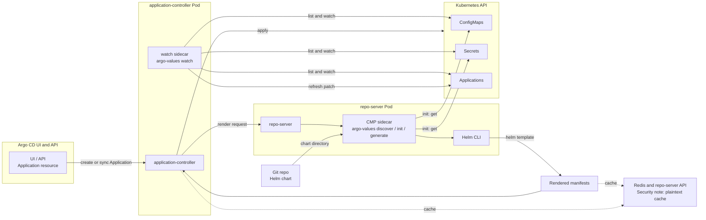
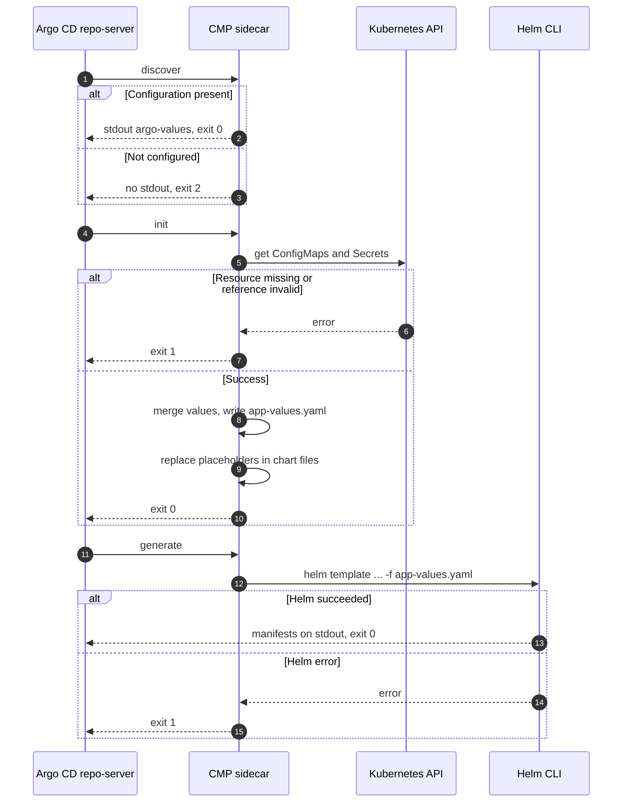
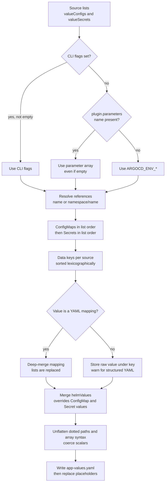
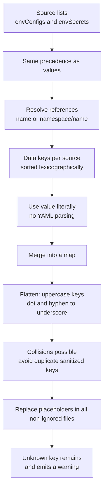
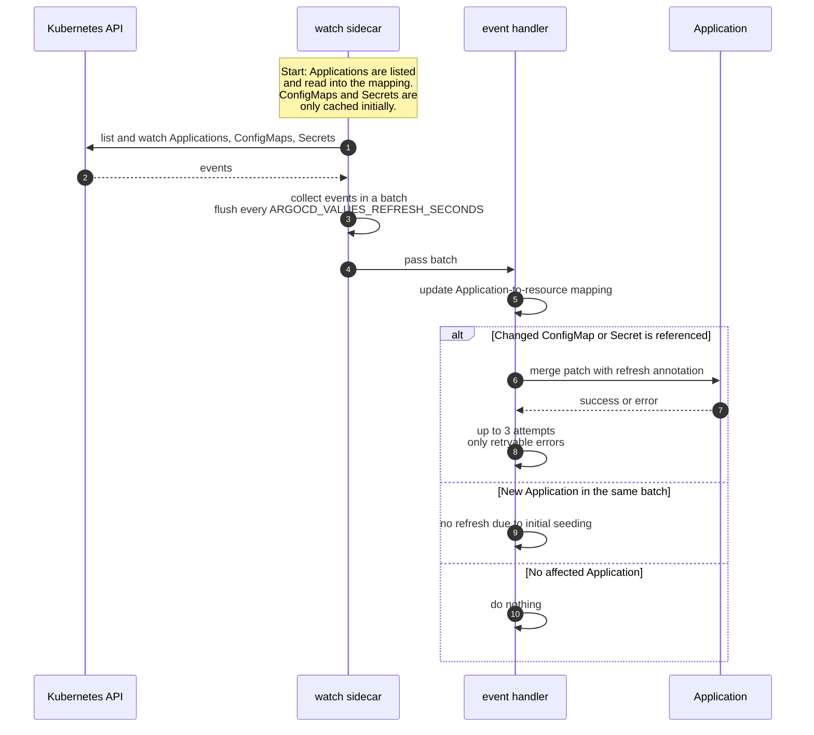
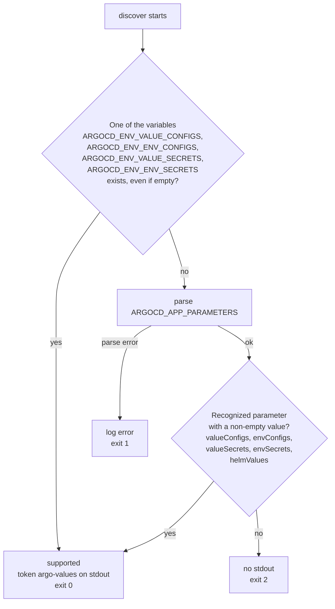

# How It Works

This page describes the architecture and flows of `argo-values`. Two paths are
important: the **render path** in the repo-server and the optional **refresh path**
in the application-controller.

## Components and Paths

**Reading:** The render path runs exclusively in the repo-server. The `watch`
sidecar observes the Kubernetes API in the application-controller and patches
Applications so that Argo CD starts a new render operation. The two paths share no
process state.

## Roles and Lifecycle

| Phase | Runs in | Purpose |
| --- | --- | --- |
| `discover` | repo-server (CMP sidecar) | decides from the configuration whether `argo-values` is responsible for the Application |
| `init` | repo-server (CMP sidecar) | reads ConfigMaps/Secrets, merges values, writes the values file, and replaces `${VAR}` in chart files |
| `generate` | repo-server (CMP sidecar) | runs `helm template` and emits the manifests on stdout |
| `watch` | application-controller (separate sidecar) | watches resources and triggers refresh patches |

`discover` decides **only from the configuration**, not from the existence of
ConfigMaps or Secrets. `init` is the first step that actually reads resources and
fails on missing or invalid references.

## Sequence: discover → init → generate

**Error paths:** `discover` exits with code `2` when the Application is not
configured. A broken `ARGOCD_APP_PARAMETERS` already causes exit `1` in `discover`.
`init` and `generate` report runtime and configuration errors with exit `1`. See
the [Reference](reference.md#exit-codes) for an overview.

## Value Resolution: Values

**Reading:** Precedence applies per source list: CLI flags override
`plugin.parameters`, and `plugin.parameters` overrides `plugin.env`. `helmValues`
is available only through `plugin.parameters` and is merged last.

## Value Resolution: Env

**Reading:** Env values are never interpreted as YAML. The key `db.host` becomes
the environment variable `DB_HOST`; the chart references it as `${DB_HOST}`.
`${db.host}` is also sanitized to `DB_HOST`.

## Sequence: watch and Refresh

**Reading:** Initial seeding only builds the mapping and does not trigger any
refreshes. ConfigMaps and Secrets are not reported as events on startup. A new
Application that appears in the same batch as a resource change is not refreshed
yet. The patch sets the annotation `argocd.argoproj.io/refresh: hard`.

## Decision Tree: discover

**Reading:** The mere existence of an `ARGOCD_ENV_*` variable is sufficient, even
with an empty value. If such a variable is present, `ARGOCD_APP_PARAMETERS` is not
parsed during discovery; broken JSON is only detected in `init`. Unknown
parameters and empty arrays do not count as support.

## State and Namespace Resolution

Between `discover`, `init`, and `generate`, state is passed **only through files**,
not through process environment. `init` writes the values file
`<file-target>/<file-values>` (default `./app-values.yaml`), and the subsequent
substitution reads and writes files in the chart directory. `generate` reads the
values file via `-f`.

Namespace resolution is a common pitfall:

- `ARGOCD_APP_NAMESPACE` is the Application's **destination namespace**, not the
  namespace of the Application resource.
- `init` resolves unqualified references against `ARGOCD_APP_NAMESPACE` (fallback
  `default`).
- `watch` resolves unqualified references from Application specs against
  `spec.destination.namespace` (fallback `default`).
- `generate` uses `ARGOCD_APP_NAMESPACE` as the Helm `--namespace`. The flag
  default `argocd` applies only when the environment variable is missing (for
  example, in a manual run).

Therefore, qualify references as `namespace/name` whenever in doubt.
